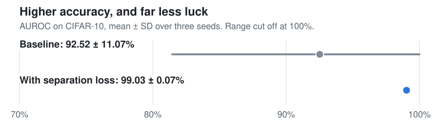
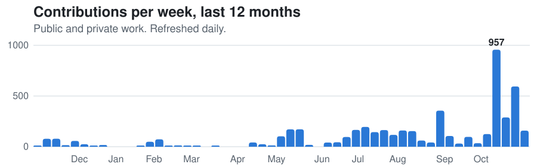

<picture>
  <source media="(prefers-color-scheme: dark)" srcset="assets/hero-dark.svg">
  <source media="(prefers-color-scheme: light)" srcset="assets/hero-light.svg">
  
</picture>

I build AI systems end to end: training and evaluating models, turning LLMs into working products, and writing the tooling that keeps coding agents honest. Open to AI/ML engineer roles and available now.

[Portfolio](https://ahmed-3m.github.io/) · [LinkedIn](https://www.linkedin.com/in/ahmed-3m/) · [Hugging Face](https://huggingface.co/ahmed-3m) · [Thesis PDF](https://ahmed-3m.github.io/Mohammed_Ahmed_Thesis_Diffusion_OOD_Detection.pdf) · [ORCID](https://orcid.org/0009-0004-8934-1270)

## What I do

- **Applied machine learning.** Python, PyTorch, Lightning, Diffusers, YOLOv8 and Weights & Biases, from experiment design to results that hold up across seeds.
- **LLM products.** Multi-provider routing, vector memory, scheduled jobs and evals behind a live assistant.
- **Agent tooling.** Deterministic checks and workflows for AI coding agents. I build with Claude Code and Copilot openly, and my TypeScript and web work is AI-assisted.

## Selected work

| Project | What it is |
|---|---|
| [**mergeproof**](https://github.com/ahmed-3m/mergeproof) | Decides whether a pull request written by an AI agent is safe to merge. Plain deterministic code that never calls an LLM, so the agent being judged cannot talk its way past it. |
| [**Sihem**](https://sihem-pwa.pages.dev/) | An assistant for habits and daily routines, delivered as a Telegram bot and an installable web app. Solo side project, accepted into the tech2b incubator in Linz. Code is private. |
| [**DiffusionOOD**](https://github.com/ahmed-3m/DiffusionOOD) | M.Sc. thesis code (graded 1). A conditional diffusion model with a separation loss reaches 99.03 ± 0.07% AUROC on CIFAR-10 over three seeds. |
| [**InkjetOOD**](https://github.com/ahmed-3m/InkjetOOD) | The thesis method on industrial data: YOLOv8 plus a diffusion classifier for print quality control, on PROFACTOR's public FTI_Zer0P dataset. |
| [**Elbostan Pazar bot**](https://github.com/ahmed-3m/Elbostan-Pazar-bot) | A Messenger bot that answers a real shop's customers about prices, hours and delivery. |
| [**brainstorm2idea**](https://github.com/ahmed-3m/brainstorm2idea) and [**idea2prototype**](https://github.com/ahmed-3m/idea2prototype) | Zero-dependency tools that take a fuzzy idea to a linted brief, then to a tested prototype, with any coding agent. |

<strong>The thesis result in one chart</strong>

 

<picture>
  <source media="(prefers-color-scheme: dark)" srcset="assets/thesis-dark.svg">
  <source media="(prefers-color-scheme: light)" srcset="assets/thesis-light.svg">
  
</picture>

Five external benchmarks score between 90.50% and 96.97% AUROC. The ROC curves below are drawn from the audited raw scores of seed 42, where the within-CIFAR AUROC is 98.98%.

[Thesis LaTeX source](https://github.com/ahmed-3m/thesis-diffusion-ood-latex)

## Latest work

<!-- latest-work:start -->
- Nov 9, 2026: Sync llms.txt / llms-full.txt with the refreshed CV facts ([ahmed-3m.github.io #200](https://github.com/ahmed-3m/ahmed-3m.github.io/pull/200))
- Nov 9, 2026: Retry empty commit-PR association with backoff in main-guard ([mergeproof #69](https://github.com/ahmed-3m/mergeproof/pull/69))
- Nov 8, 2026: Bespoke OG cards + footer internal links ([ahmed-3m.github.io #197](https://github.com/ahmed-3m/ahmed-3m.github.io/pull/197))
- Nov 8, 2026: Align portfolio identity with the redesigned GitHub profile ([ahmed-3m.github.io #196](https://github.com/ahmed-3m/ahmed-3m.github.io/pull/196))
- Nov 7, 2026: Reconcile AUROC numbers + legible τ label; refresh agent docs ([ahmed-3m.github.io #193](https://github.com/ahmed-3m/ahmed-3m.github.io/pull/193))
<!-- latest-work:end -->

## Activity

<picture>
  <source media="(prefers-color-scheme: dark)" srcset="assets/activity-dark.svg">
  <source media="(prefers-color-scheme: light)" srcset="assets/activity-light.svg">
  
</picture>
