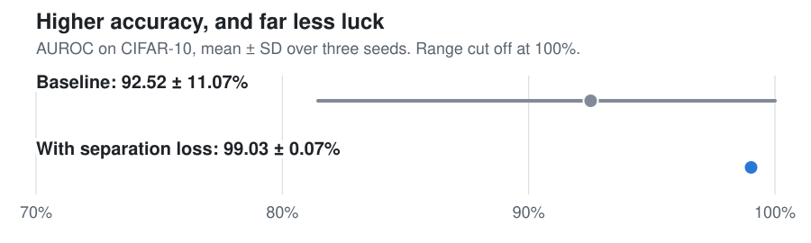
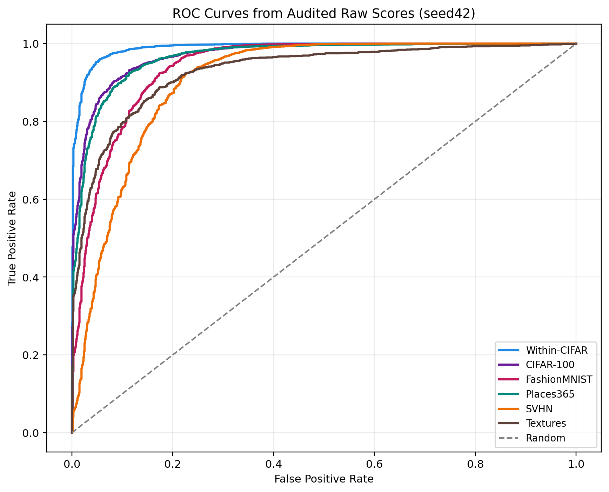
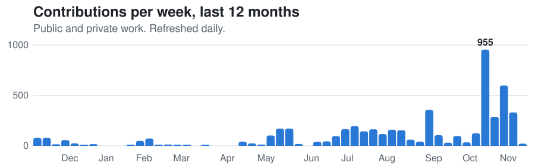

<picture>
  <source media="(prefers-color-scheme: dark)" srcset="assets/hero-dark.svg">
  <source media="(prefers-color-scheme: light)" srcset="assets/hero-light.svg">
  
</picture>

I build reliable vision and agentic AI systems that pair probabilistic models with deterministic guardrails, across industrial print inspection, diffusion OOD detection, and LLM and agent tooling. Based in Linz, Austria, open to AI/ML engineer roles and available now (eligible for Austria's Rot-Weiß-Rot Karte für Studienabsolventen — no labour-market test).

[Portfolio](https://ahmed-3m.github.io/) · [CV (PDF)](https://ahmed-3m.github.io/cv.pdf) · [LinkedIn](https://www.linkedin.com/in/ahmed-3m/) · [Hugging Face](https://huggingface.co/ahmed-3m) · [W&B](https://wandb.ai/ahmed-mu-0593) · [Thesis PDF](https://ahmed-3m.github.io/Mohammed_Ahmed_Thesis_Diffusion_OOD_Detection.pdf) · [ORCID](https://orcid.org/0009-0004-8934-1270)

## What I do

- **Applied machine learning.** Python, PyTorch, Lightning, Diffusers, YOLOv8 and Weights & Biases, from experiment design to results that hold up across seeds.
- **LLM products.** Multi-provider routing, vector memory, scheduled jobs and evals behind an assistant in invitation-only beta.
- **Agent tooling.** Deterministic checks and workflows for AI coding agents. I build with Claude Code and Copilot openly, and my TypeScript and web work is AI-assisted.

## Selected work

| Project | What it is |
|---|---|
| [**mergeproof**](https://github.com/ahmed-3m/mergeproof) | Checks AI-agent pull requests against configured deterministic merge requirements (`MERGE`, `RETRY`, `HUMAN`) with `0` LLM calls, so the agent being judged cannot talk its way past the gate. Passing deterministic checks does not guarantee defect-free code. |
| [**Sihem**](https://sihem-pwa.pages.dev/) | Assistant for habits and daily routines in invitation-only beta on Telegram and PWA (with a native Kotlin/Jetpack Compose Android app in private testing), built around a deterministic `generators → arbiter → composer` loop and `pgvector` memory. Solo side project, accepted into the tech2b incubator in Linz. Code is private. |
| [**DiffusionOOD**](https://github.com/ahmed-3m/DiffusionOOD) | M.Sc. thesis code (graded 1). A conditional diffusion model with a class-conditional separation loss reaches 99.03% ± 0.07% AUROC on CIFAR-10 airplane-vs-rest (binary, single ID class, 3-seed mean; +6.5 pp over 92.52% ± 11.07% baseline). |
| [**InkjetOOD**](https://github.com/ahmed-3m/InkjetOOD) | The thesis method on industrial data: YOLOv8 plus a conditional diffusion classifier for print quality control, establishing a verified baseline of 0.8673 ± 0.0230 AUROC under 5-fold cross-validation on PROFACTOR's public `FTI_Zer0P` dataset. |
| [**Elbostan Pazar bot**](https://github.com/ahmed-3m/Elbostan-Pazar-bot) | A Messenger bot that answers a real shop's customers about prices, hours and delivery. |
| [**brainstorm2idea**](https://github.com/ahmed-3m/brainstorm2idea) and [**idea2prototype**](https://github.com/ahmed-3m/idea2prototype) | Zero-dependency tools that take a fuzzy idea to a linted brief, then to a tested prototype, with any coding agent. |

<strong>The thesis result in one chart</strong>

 

<picture>
  <source media="(prefers-color-scheme: dark)" srcset="assets/thesis-dark.svg">
  <source media="(prefers-color-scheme: light)" srcset="assets/thesis-light.svg">
  
</picture>

Five external benchmarks score between 90.50% and 96.97% AUROC. The ROC curves below are drawn from the audited raw scores of seed 42, where the within-CIFAR AUROC is 98.98%.

[Thesis LaTeX source](https://github.com/ahmed-3m/thesis-diffusion-ood-latex)

## Latest work

<!-- latest-work:start -->
- Nov 25, 2026: Refine portfolio positioning, Sihem showcase, card surfaces, and RTL support ([ahmed-3m.github.io #261](https://github.com/ahmed-3m/ahmed-3m.github.io/pull/261))
- Nov 24, 2026: Open the AI front desk in the portfolio's light or dark theme ([ahmed-3m.github.io #260](https://github.com/ahmed-3m/ahmed-3m.github.io/pull/260))
- Nov 24, 2026: Impressum and privacy notice pages ([ahmed-3m.github.io #259](https://github.com/ahmed-3m/ahmed-3m.github.io/pull/259))
- Nov 24, 2026: AI front desk button with a data notice ([ahmed-3m.github.io #258](https://github.com/ahmed-3m/ahmed-3m.github.io/pull/258))
- Nov 24, 2026: List only /sitemap.xml in robots.txt ([ahmed-3m.github.io #257](https://github.com/ahmed-3m/ahmed-3m.github.io/pull/257))
<!-- latest-work:end -->

## Activity

<picture>
  <source media="(prefers-color-scheme: dark)" srcset="assets/activity-dark.svg">
  <source media="(prefers-color-scheme: light)" srcset="assets/activity-light.svg">
  
</picture>
