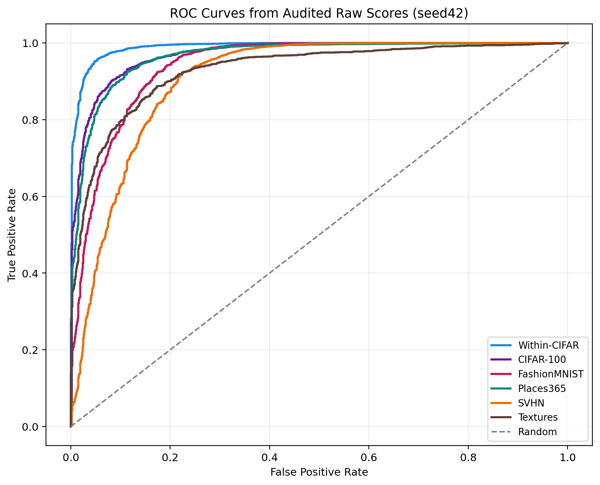

# Ahmed Mohammed

AI/ML engineer · Linz, Austria · M.Sc. AI, JKU Linz

I train conditional diffusion models that separate familiar samples from unfamiliar ones, and I carry that detector from a CIFAR-10 thesis result to an inkjet inspection line.

CIFAR-10 out-of-distribution detection, conditional diffusion, seed 42. Thesis-reported peak figure: 99.03% AUROC. The plot is the audited curve, not a redraw.

## [DiffusionOOD](https://github.com/ahmed-3m/DiffusionOOD)

Conditional diffusion with a separation loss for out-of-distribution detection. Thesis result: 99.03% AUROC on CIFAR-10.

## [InkjetOOD](https://github.com/ahmed-3m/InkjetOOD)

The same detector carried onto industrial inkjet inspection.

## [Sihem](https://sihem-pwa.pages.dev/)

A live personal-assistant app. The codebase is private; this is the public site.

## Also

- [Portfolio](https://ahmed-3m.github.io/) — Public site. Next.js portfolio, and the public face of Sihem.
- [Thesis PDF](https://ahmed-3m.github.io/Mohammed_Ahmed_Thesis_Diffusion_OOD_Detection.pdf) — Full thesis.
- [Thesis source](https://github.com/ahmed-3m/thesis-diffusion-ood-latex) — LaTeX source of the thesis.
- [Hugging Face](https://huggingface.co/ahmed-3m) — 32 public models, including self-training experiments (DPO-ST, SDPO, LaSeR).
- [Elbostan Pazar bot](https://github.com/ahmed-3m/Elbostan-Pazar-bot) — A Messenger bot that answers a shop's customer questions.
- [Motor imagery](https://github.com/ahmed-3m/Motor-Imagery-classification) — Finished 2024 work: motor-imagery classification for a brain-computer interface.
- [LinkedIn](https://www.linkedin.com/in/ahmed-3m/)

Open to AI/ML engineer roles — applied research and product work.
